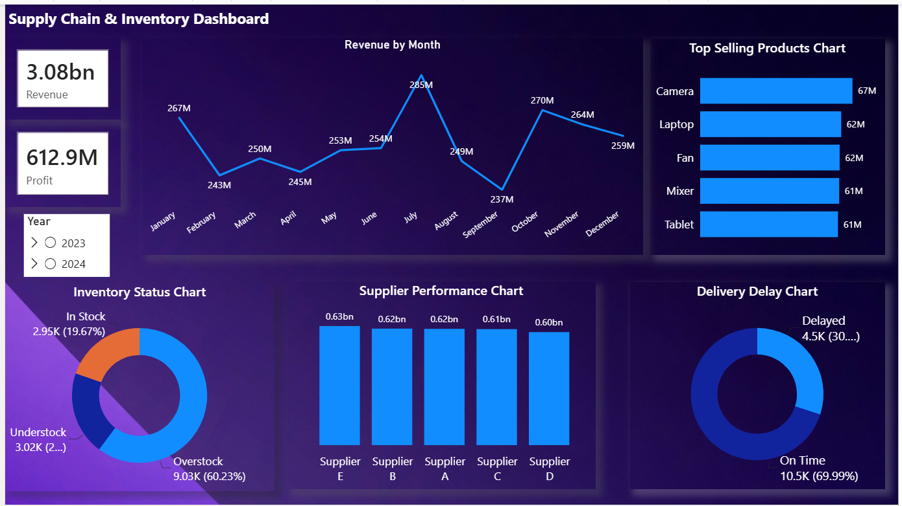

# Supply Chain and Inventory Analysis

Analysis of inventory levels, supplier delivery performance and product profit across 15,000 supply chain records, to show where excess stock and late deliveries cost the business money.

**Tools:** Excel (cleaning and analysis), Power BI (dashboard)
**Data:** 15,000 records, 2023 to 2024. Source: [add dataset source or link]



## Headline numbers
| Metric | Value |
|---|---|
| Revenue (units sold x selling price) | 3.08bn |
| Profit (selling price - purchase cost) | 612.9M |
| Units sold | 2.22M |
| Average shipping time | 5.5 days |

## Business questions and findings

**1. Is inventory well managed?**
Not really. 60.23% of records are overstocked, about 20% are understocked and 19.67% are in stock. Total stock held (3.76M units) is about 1.7x the units sold (2.22M), so excess stock tying up capital is a bigger problem than shortages.

**2. Which products are frequently out of stock?**
Tablet (328 understock instances), Camera (326), AC (305), Laptop (304) and Phone (304).

**3. Which suppliers have the most delivery delays?**
Supplier E had the most delays (929). A delivery counts as delayed if the product arrived after 7 days. Units sold are fairly balanced across suppliers (Supplier E highest at 452,768 and Supplier D lowest at 431,563).

**4. What is the impact of delivery delays?**
Of 15,000 deliveries, 10,498 (70%) were on time and 4,502 (30%) were delayed. The delay rate is linked to about a 7.6% drop in revenue, profit and units sold.

**5. Which products make the most profit?**
Camera (67.3M), Laptop (62.3M) and Fan (61.6M) lead. Shoes (57.9M) has the highest profit margin at 20.43% but sells fewer units.

**6. Which products move fast or slow?**
Using stock turnover ratio (units sold / stock held), Camera is the fastest (0.624). Shoes sells the fewest units.

## Recommendations
- Lower reorder levels for slower movers (Shoes, TV, AC) and shift stock toward high-turnover items such as Camera and Laptop.
- Prioritise delivery reliability for Camera, Laptop and Mixer, where value and delay risk are both high.
- Review Supplier E's lead times, since it has the most delays.
- Track overstock, understock and delay rate regularly as dashboard KPIs.

## Cleaning and analysis (Excel)
[Add 3 to 5 bullets in your own words: duplicates removed, missing values handled, columns you created such as stock status, delay flag and turnover ratio.]

## Repository contents
```
├── README.md
├── data /        dataset in excel or a link and column list
├── excel/       analysis workbook (.xlsx)
├── dashboard/   Power BI file (.pbix)
├── images/      dashboard screenshots
└── report/      report PDF
```
